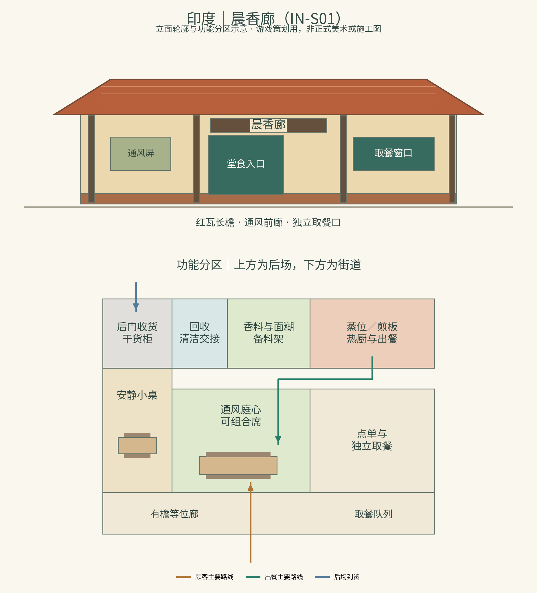
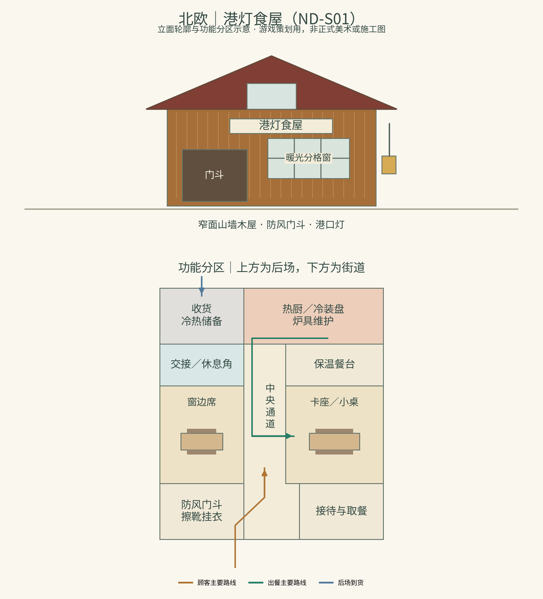
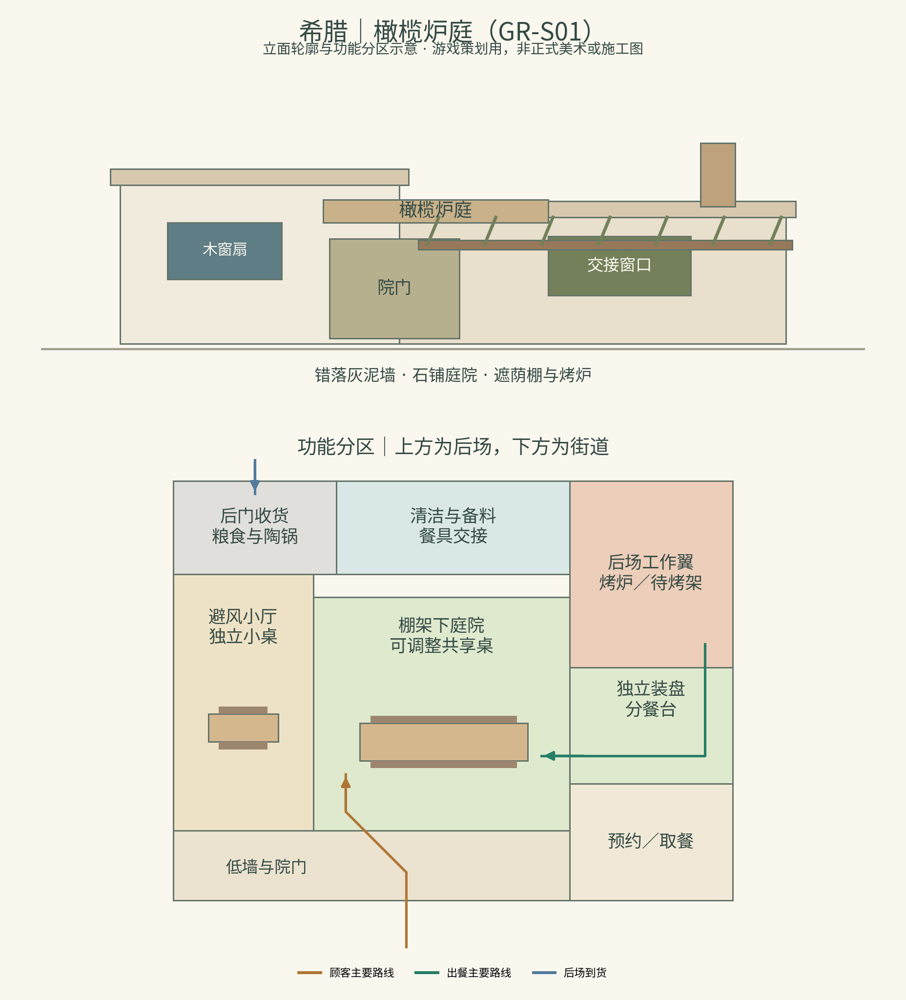

# 《山海食肆物语》跨文化分店综合策划案

**地区：印度、北欧、希腊｜版本：角色、菜品与店面整合第二稿｜日期：2026-11-05**

本稿为后续开发方案，尚未加入游戏。每个地区设计5位角色、5道菜品，共15位角色、15道菜品；角色合作方式包括长期伙伴、巡回来客与季节顾问，不要求全部采用抽卡招聘。

本次在第一稿完整角色、菜品和剧情的基础上，加入三家餐馆的外立面、入口、空间分区、材质配色、灯光、动线与升级选择，整合到各地区章节。文中的店名均为游戏原创工作名；配图为立面轮廓及功能分区示意，不是正式美术效果图或现实建筑施工图。

## 一、整体方向：从山海小馆出发，与当地伙伴共同开店

建议沿用山海主店、驿路、分店和来信的世界框架。主店收到三封邀请，玩家选择一处跨文化街区，与当地伙伴一起决定菜单、供货、排班和空间布置。山海员工带来自己的经验，也会在当地伙伴的帮助下学习新做法。

每家分店保留一个山海来源的锚点，例如旧店匾、一本往来菜单或一位交流员工；当地神话角色、菜品和生活方式则真正影响日常经营。当地伙伴有自己的目标、专业意见和决定权，能够对玩家方案提出修改。

| 地区 | 首轮空间设定 | 经营重点 | 玩家能感受到的区别 |
| --- | --- | --- | --- |
| 印度 | “晨香廊”：以卡纳塔克沿海市集为主要空间参考，与不同地区的厨师、商贩合作 | 香料备料、发酵排程、不同用餐需求的履约 | 同一台灶做什么、先准备什么、哪些工序可以共用，都影响接单能力 |
| 北欧 | “港灯食屋”：以挪威伯根一带海港木屋为主要参考，接入丹麦、瑞典菜单合作 | 季节供货、天气路线、腌渍与热食、储备和保温 | 新鲜供货与储备菜单形成取舍，天气预告改变采购、配送和排班 |
| 希腊 | “橄榄炉庭”：以基克拉泽斯群岛、锡夫诺斯等岛屿食肆为主要参考的虚构港口院落 | 烤炉批次、单人份与共享份、季节菜单和餐桌安排 | 同一批菜怎样分装、何时入炉、怎样安排桌位，会改变等待与服务工时 |

地域范围需要说清楚：印度包含多种语言、宗教与饮食传统；北欧也包含多种神话和地方文化。本稿印度角色选取印度史诗及相关神话原型；北欧角色采用古诺尔斯神话与挪威、丹麦、瑞典一带的部分民俗，不将芬兰神话、萨米传统统一算成同一体系。希腊部分以希腊神话为主，阿拉克涅故事的主要传世依据则单独标明为拉丁文作品。

菜单选择的是当代仍可辨认的地方饮食及其游戏配方。现代菜品可以与神话角色相遇，不因此被写成神话时代已经存在的食物。

## 二、三地共用的设计规则

### 1. 先完成当地菜单，再开放协作菜

每地5道基础菜保留本地名称、核心食材和主要工序。玩家先学会它们，再可与山海伙伴共同开发明确标注的协作版本；本稿不另外把协作变体计入15道基础菜。

改辣度、换蛋白、去乳制品等调整，需判断能否成立，并显示配方差别。不能接的要求可在接单前说明并推荐其他菜。个人需求由顾客自己表达，不根据国籍或外貌自动推断。

### 2. 角色特征应带来不同决策

每位角色至少连接一个经营动作、一个限制条件和一条后续反馈。原典只提供形貌、关系或文化意象；岗位、姓名之外的原创称号、技能、餐馆经历与对白均属游戏创作。下文族类角色均为**基于该原型创作的一位独立人物**，不是将整个族类当成一个员工。

### 3. 评价对应实际服务

反馈关注实际交付、等待、成本、员工负担和客人理解情况。当地顾客也会有不同偏好，不设置统一的“印度口味”“北欧口味”或“希腊口味”，不增加抽象的“文化纯度”分数。

自动经营继续成立。排程、备料、分装等可通过菜单选择完成，短时手动试作作为可选体验，不要求玩家反复操作才能维持收益。

### 4. 店面特色同时进入外观与使用方式

三个地区各选一个具体的空间参考，再容纳跨地区菜单。店铺所在街区与菜品来源可以不同，资料页分别说明；不把同一国家或地区的所有建筑风格拼到一家店。

三家店继续使用现有俯视像素场景与水墨角色立绘。地区差异主要通过屋顶轮廓、门窗、遮蔽方式、地面与家具、设备位置、光线和动作表达；操作按钮和信息层级保持一致。

共同保留六项功能：到店接待、堂食、取餐、备料烹饪、收货储藏、清洁交接。顾客、出餐和供货路线分别标记，脏餐具在回收台集中后再转运；配图只表达主要分区，精确的家具碰撞、通道宽度和寻路需要在原型中校对。

| 店面 | 远景识别 | 近景细节 | 影响经营的主要空间选择 |
| --- | --- | --- | --- |
| 晨香廊 | 红瓦长檐、通风廊道、街侧取餐窗口 | 香料备料柜、透空屏、棉帘、院角植物与交接板 | 有限临街面积分配给等位、取餐或堂食；煎板、蒸位与备料台排程 |
| 港灯食屋 | 窄面山墙木屋、分格窗、防风门斗、港口灯 | 挂衣与擦靴处、保温餐台、夜班交接角、可见储备 | 门斗和储藏占面积但缓解天气影响；夜班、维护和早班需交接 |
| 橄榄炉庭 | 错落灰泥墙、石铺庭院、遮荫棚架与炉烟囱 | 陶锅、分餐台、可移动桌席、织物遮帘 | 共享桌与独立席的比例、炉次、装盘与餐具周转 |

每家店只保留一处清晰的山海联系，例如原店木匾、双方署名菜单和往来信箱。它们体现合作经历，其余空间优先服务当地伙伴和街区生活。

## 三、印度分店：香料与清晨的市集

### 1. 地区体验

清晨先处理发酵面糊和蒸制早餐，午间准备鹰嘴豆与米饭，傍晚接受小型聚餐。玩家逐渐发现，“香料多”并不等于“辣椒多”，素食、含乳、无蛋和完全植物性也需要分别说明。

首家店选取卡纳塔克沿海、门格洛尔一带的市集与日常食肆作为主要空间参考。这里是一家接受多地厨师合作的游戏原创餐馆，因此菜单仍保留南印度、北印度和海得拉巴等具体来源，不把它们全部改称当地菜。

### 2. 五位角色

#### IN-01 迦楼罗 · 驿路合作伙伴（Garuḍa）

- **文化依据：**印度神话中的神鸟，与毗湿奴关系密切；《摩诃婆罗多》初篇相关叙事涉及迦楼罗、母亲毗娜达及取得甘露的经历。其与那伽的关系有具体故事背景。
- **形象与性格：**保留鸟喙轮廓、金色羽翼与爪的辨识度，采用适合短暂停留的旅行装。说话直率，尤其重视“答应送到”与“真的送到”的区别。
- **经营作用：**作为巡回合作伙伴，开放一次有载重和天气条件的加急采购。加急需要预约、运费与地面交接人员，不能凭空增加食材，也不能无限连续使用。
- **人物事件：**普通商路延误。选择加急少量关键食材，可保住限定订单但增加成本；调整当日菜单，则节省运费并需提前告知客人。回信分别记录履约或换菜是否完成。
- **故事句：**“他把最后一袋米放到门边，先问的不是谢礼，而是哪一桌还在等。”

#### IN-02 莲池守望者 · 那伽伙伴（Nāga，原创个体）

- **文化依据：**那伽是南亚多种传统中的蛇类或蛇形神异存在，部分叙事与水域、守护和财富相关；不同作品中的性格与立场并不相同。
- **形象与性格：**一位熟悉水池和市集的当地伙伴，上身具人形、下身保留蛇尾与细鳞，配色从莲池水色取样。性格细致，习惯在交接簿上写清时间。
- **经营作用：**协助安排面糊发酵、清水使用与湿区动线。玩家选择分批备料或集中备料：前者更灵活、占工时，后者容量大但需要准确预计需求。神话特征作为叙事表达，发酵仍遵守原料、温度和时间条件。
- **人物事件：**早餐客流突然增加。立即接满订单可能超过煎板和面糊产能；分时接单并给出等待说明，则收入较稳、短期客流较少。
- **故事句：**“池水会记得雨来过，面糊也会记得你等了多久。”

#### IN-03 林库守者 · 夜叉采购员（Yakṣa，原创个体）

- **文化依据：**夜叉在印度多种宗教与文学传统中具有复杂形象，部分与自然、地方守护和财富联系；本角色选用林地与库藏守护的意象。
- **形象与性格：**结实身形、植物纹样腰带、种子袋和刻有交接记号的木箱。喜欢把食材放在能追溯来处的位置，反对把“买得多”当成“买得好”。
- **经营作用：**解锁供应批次对照：单价、送达时间、可保存时长和预付款。核对占用采购工时，不能自动预知未来市场价格。
- **人物事件：**商人提出大批香料折扣。整批采购降低单价、占用现金与仓位；小批定期采购提高周转、增加运输成本。结局按真实耗用和剩余库存呈现。
- **故事句：**“仓库有余粮是好事，仓库里只有无人再打开的袋子，就不是了。”

#### IN-04 香料谱师 · 乾闼婆厨师（Gandharva，原创个体）

- **文化依据：**乾闼婆常与天界音乐相关，在印度文学与神话中有多种记述。把音乐节奏转化为烹饪提示属于本作创作。
- **形象与性格：**保留弦乐器与演奏者的手部特征，工作时收好乐器、使用独立备料工具。对香气有耐心，也愿意接受客人说“这不适合我”。
- **经营作用：**整理两套明确命名的香料备料组合，配合不同菜品排程。低辣度可以保留其他香气；混合物需提前制作，占用备料台和库存。可选试作通过节拍提示入锅顺序，自动员工也能学习。
- **人物事件：**聚餐客人提出“希望有香气，但辣椒少一些”。选择现有适配菜并说明差别，可立即履约；预约共同试作，则需要时间并可能获得新反馈。
- **故事句：**“他没有往锅里再加一勺辣椒，只把盖子揭开，让你先闻一闻。”

#### IN-05 席间引舞者 · 阿普莎拉领席（Apsarā，原创个体）

- **文化依据：**阿普莎拉是相关神话与文学中的天界女性形象，常与舞蹈、音乐等联系。本角色的餐馆工作与个人经历为原创。
- **形象与性格：**服饰参考具体地区的舞蹈与织物资料后设计，保留流动衣褶与清晰手势。她善于观察人群，也会主动给不愿参与热闹的客人留空间。
- **经营作用：**安排聚餐、等位与外带三条接待路径。表演活动需要场地和额外人手；不办表演也可采用安静席位、预约取餐，分别服务不同需求。
- **人物事件：**节庆夜有人想看演出，也有人只想及时吃饭。划分时段能兼顾两类客人但降低即时翻台；增加服务人员可缩短等待，同时提高工资成本。
- **故事句：**“她先替最不想跳舞的人找好座位，才回身向乐师点了点头。”

### 3. 五道菜品

下列用料是拟定的游戏配方，后续经食谱核对与试作再定稿；同名菜在不同地区、家庭和餐厅可以有不同版本。

| 编号与菜品 | 地域说明及拟定用料 | 核心工序与经营选择 | 菜牌说明与呈现 |
| --- | --- | --- | --- |
| IN-D01 马萨拉多萨（Masala dosa） | 南印度饮食传统中的代表性选择；米与乌豆发酵面糊，土豆、洋葱、芥菜籽及香料；本店基础版用植物油 | 提前发酵→煎薄饼→加入馅料；煎板即时产能有限，预约早餐批次影响等待。低辣调整降低辣椒量，保留其他调味 | 本配方不加乳、蛋；蘸料须单独列用料。外带分装馅料与蘸料可减缓软塌，但增加包材成本 |
| IN-D02 鹰嘴豆配炸面饼（Chole bhature） | 与旁遮普及北印度饮食联系密切；鹰嘴豆、番茄、洋葱、香料；小麦面饼，本店面团选用酸奶 | 豆酱提前炖煮、面饼接单现炸；大批预炸出餐快但口感下降，现炸占用油锅。菜酱和面饼分别计工序 | 标明含小麦、乳。不能因为主料是鹰嘴豆就标成无乳或完全植物性；配图突出饼的鼓起形态 |
| IN-D03 海得拉巴风味鸡肉比尔亚尼（Hyderabadi-style chicken biryani） | 海得拉巴风味样例；长粒米、鸡肉、酸奶、洋葱、香料；本店基础配方不加坚果 | 腌制→米饭处理→分层焖制；整锅有较长准备时间，预约大锅降低单位工时，但临时换单较难 | 标明鸡肉与乳；用中文解释为分层焖制的调味米饭。是否符合特定饮食要求须依实际原料与制作条件确认 |
| IN-D04 伊德利配桑巴汤（Idli with sambar，按一道组合餐计） | 南印度早餐样例；发酵米豆蒸糕，配扁豆、蔬菜、罗望子和香料汤；本店采用植物油配方 | 蒸糕批次与汤锅并行；蒸位可大量出餐，但需要与多萨协调面糊准备。分别研发两者的面糊配比，不把面糊视为万能共用原料 | 本店配方不加乳、蛋；汤的酸味来源和辣度说明可展开查看。配图保留白色蒸糕与独立汤碗 |
| IN-D05 古拉布贾蒙（Gulab jamun，糖浆乳团） | 印度及南亚广泛流传的甜点；本店选乳固形物、少量小麦粉、糖浆、豆蔻与玫瑰水配方 | 成团→低温炸制→浸糖浆；需提前准备，按批出售。小批甜点可补充午间以外收入，过量备货会积压 | 标明乳、小麦，不默认含坚果或额外添加坚果装饰。解释玫瑰水是本配方调香用料，不声称所有版本都一样 |

### 4. 首条完整剧情：“一张早餐单，三种安排”

**相遇：**莲池守望者邀请主店参加食街早餐日。夜叉采购员提供两份到货方案，乾闼婆厨师说明发酵与备料条件。

**接单前：**客人分别提出无乳需求、低辣需求和赶时间取餐需求；这是三位具体客人的选择，不代表当地全部食客。

**玩家方案：**

- 提前分批备料、限制预约人数：采购与排班更容易控制，收入上限较低。
- 增加一段准备班次、购买少量加急原料：可接受更多订单，但工资和运输成本增加。
- 暂不接受超出能力的定制：推荐已能确认用料的餐点，并清楚说明原因。

**实际经营：**面糊、蒸位和煎板形成真实队列。不能只点一次对话就自动获得好评，需完成对应出餐。

**结尾：**迦楼罗带回顾客的短笺，分别提及准时、风味解释和用料承诺；未完成的承诺进入后续补救。玩家在阅读中再认识角色来源。

### 5. 店面设计：晨香廊（IN-S01，原创店名）

**定位：**市集街角的早餐与全天食肆，外侧方便停留、点单和取餐，内侧留出较安静的用餐区域。设计关键词为“红瓦、深檐、通风、晨间备料”，不是宫殿或宗教建筑的缩小版。

#### 外立面、招牌与入口

| 部位 | 拟议设计 | 当地特色与实际作用 |
| --- | --- | --- |
| 屋顶与檐廊 | 以门格洛尔一带红瓦坡屋顶为主要形制参考，低而连续的深檐覆盖前廊 | 形成清楚的街面轮廓；廊下容纳短时等位和取餐，雨天仍能组织队列 |
| 墙体与门窗 | 浅赭灰泥墙、红褐色基座、深木色门窗，局部采用透空通风屏 | 热湿环境下的遮蔽和通风作为空间设定；透空纹样需依具体参考设计，不假装全国统一样式 |
| 门头 | 深木框招牌配简洁几何边饰；保留当地店名与合作者小标牌位置 | 在手机远景中先读出店名，装饰不覆盖文字。当地文字待校对后使用，不让AI生成伪文字 |
| 前廊与门口 | 主入口居中偏左，取餐窗口靠右，接单板面向街道 | 等位、堂食入店和取餐分开指示，减少聚在同一按钮或门口的位置 |
| 植物与纹样 | 院角小株植物、可收起的棉帘、局部可更新的迎客地面纹样 | 增加生活气息；具体纹样来源登记，保留道路和角色轮廓，不把图案铺满全场 |

建议色彩：浅砂色 `#F2E5CA`、瓦红 `#B65F3A`、深木褐 `#5F4535`，以少量青绿 `#28665E` 与暖黄 `#C99534` 点缀。大面积用色落在墙地与屋瓦，小面积亮色用于门牌、工具和状态；不用国旗配色直接代替建筑设计。

#### 平面分区与动线

示意图的上方是后场，下方是街道，仅表达相对位置和主要流程。

- **前部：**带檐前廊，左侧等位与菜单，中央进入堂食，右侧独立取餐窗口。实际队列不得堵住主入口。
- **中部：**安静双人席与可组合餐桌围绕通风庭心布置；聚餐活动使用可预约区域，保留不参与活动的席位。
- **后部：**收货与干货柜靠后门；清洁回收与备料有明确交接位置；香料台、发酵容器、蒸位和煎板按工序连接。
- **顾客路线：**街道看单→接待→座位或取餐窗口；堂食与外带在接待后分流。
- **工作路线：**备料→蒸/煎/炸→出餐交接→餐桌或取餐窗口；脏餐具先到回收台再进入清洁区。供应商从后侧交货，避免穿过堂食中心。

水景只保留在院角展示或独立设施中，不直接充当厨房用水来源。莲池意象与真实工作流程分开表达。

#### 与角色、菜品和事件的结合

| 空间或设施 | 对应角色/菜品 | 能在画面中看见的经营变化 |
| --- | --- | --- |
| 后侧交接点与批次标签柜 | 迦楼罗、林库守者 | 原料送达、核对、入库依次发生；加急食材不直接凭空跳到锅里 |
| 发酵容器架与清水备料台 | 莲池守望者、多萨、伊德利 | 显示准备中/可用/本批剩余；两种面糊分别标记，不能只画成一个万能罐 |
| 香料备料台与可见热厨 | 香料谱师、比尔亚尼、鹰嘴豆菜酱 | 配料准备与灶台占用分别显示；少辣调整能对应实际配方与出餐单 |
| 有檐取餐口 | 多萨、早餐组合餐 | 外带包装与交付有独立动作，等位者能看见预计取餐批次 |
| 可预约活动角与安静席 | 席间引舞者 | 活动时段、服务人手和桌位有取舍，表演不会遮住所有餐桌或强迫全部客人参与 |

“一张早餐单，三种安排”事件直接使用这些位置：需求核对在接待处发生，面糊与热厨出现真实排程，取餐承诺在窗口完成。人物经历通过工作与交流展开。

#### 灯光、时段与声音

清晨以暖色斜光照亮廊下，午间由檐与透空屏形成清楚的大块阴影；晚间用暖灯照亮入口和工作区。雨天的雨线与积水以街景和檐外为主，不覆盖菜牌与角色面部。声景可使用市集交谈、煎板与蒸汽等生活声音；音乐另行创作，不把持续宗教吟唱当作通用地区背景。

#### 升级选择

- **基础店：**前廊、简单堂食与必要蒸煎设备，先保证顺畅完成早餐。
- **合作升级：**增加发酵分架或外带交接台。前者提高备料安排能力，后者缓解取餐拥堵，都需付出空间和费用。
- **主题活动：**划出聚餐与演出时段。扩大活动区域会减少安静席，玩家也可保留日常营业模式。

升级不以装饰数量自动换取收益；队列、工时、桌位与实际订单共同决定效果。

### 6. UI与文化阅读

- 香料台用可辨认的容器、名称和备料状态表达信息，不能只靠颜色分辨。
- 菜牌显示“已知用料—本次可调整—仍需确认”；素食、无乳、无蛋与植物性分别列示。
- 角色卡写明“神话人物”或“基于神话族类的原创人物”，保留来源入口；店面资料页说明沿海卡纳塔克参考与跨地区菜单的区别。
- 首轮沿用中文/英文界面，菜名保留通行拼写；本店后续招牌优先研究卡纳达语与英文的组合，实际文本由熟悉当地语言者校对。印地语、泰米尔语等按目标读者另行规划，不能将其中一种当作整个印度唯一语言。

## 四、北欧分店：长夜海港的暖灯

### 1. 地区体验

店开在一座以挪威伯根一带海港为主要参考的虚构街区。天气会改变到货窗口，玩家需要在新鲜食材、可保存餐点与现做热食之间安排菜单。丹麦、瑞典的合作伙伴带来各自的做法，菜牌保留地域说明。首店表现冬季日照较短的港口生活，不把伯根设定成整个冬季持续黑暗的极夜城市。

古诺尔斯神话角色与较晚的民俗角色可以在游戏中相遇，但资料页分别标注时代与来源。餐厅也采用当代可用设施，不将菜单宣传成一套历史复原的“维京宴”。

### 2. 五位角色

#### ND-01 拉塔托斯克 · 树间传信者（Ratatoskr）

- **文化依据：**《诗体埃达》《散文埃达》中，松鼠拉塔托斯克沿世界树往来，传递树顶与树根之间的言语。
- **形象与性格：**保留松鼠外形、大尾巴与攀爬动作，背着分格信袋。他反应很快，也渐渐学会把转述和已证实的消息分开。
- **经营作用：**带来天气、供货与商路消息。玩家可花费派遣工时核实一条消息；未核实信息显示范围与不确定性，不直接变成未来价格答案。
- **人物事件：**两封信对船期说法不同。核实会占用采购员时间，直接预订则可能便宜，也可能延误。结局对照真实船期与本次采购安排。
- **故事句：**“他把两封信摊在桌上，第一次没有抢着替你读出结论。”

#### ND-02 布洛克 · 炉具匠人（Brokkr）

- **文化依据：**《散文埃达·诗语法》有关宝物锻造的故事涉及矮人布洛克；不同译本对同伴名称与段落编号有差异。
- **形象与性格：**保留匠人的粗手套、工具围裙与锻造痕迹，身体比例和原有员工有所区别。喜欢实际试炉，反感看起来漂亮却挡住操作的装饰。
- **经营作用：**提供炉具维护、隔热与烤盘调整方案。改装要付材料费并让设备停用一段时间，可选择稳定批次或灵活小批出餐；不提供无限燃料或免费设备。
- **人物事件：**节日前旧炉需要维护。提前停炉会减少当天接单；租借临时设备维持供餐则增加成本。最终显示真实停机、费用与出餐结果。
- **故事句：**“他敲了敲炉门，问这家店准备让客人等多久，也问准备让厨师忙多久。”

#### ND-03 斯卡蒂 · 冬路向导（Skaði）

- **文化依据：**古诺尔斯神话中与山地、狩猎、滑雪等有关的女性神祇，身世及与尼约德的关系见埃达叙事。
- **形象与性格：**保留山地装备、滑雪板或弓的识别特征，以巡回向导身份来访。她清楚知道自己熟悉山路，却不会替海上的船长保证风浪。
- **经营作用：**提供不同距离、天气暴露和保温条件的配送路线。短路不一定容量大，长路不一定稳定；派遣时需同时考虑留店人手。
- **人物事件：**山路突然降温。减少配送量、提供晚一时段送达，或改为到店领取，均有对应等待、包材与客流影响。
- **故事句：**“她在地图上划掉一条近路，说距离短，并不意味着今天走得快。”

#### ND-04 港屋尼瑟 · 夜间管事（Nisse，原创个体）

- **文化依据：**丹麦、挪威等地民俗中的家宅或农场小精灵形象；与瑞典tomte等传统有关联，但名称和细节有地区差异。不能笼统当成埃达中的同一神祇。
- **形象与性格：**小个子、实用羊毛衣、灯笼和记事板，红帽可以采用，但不把形象限定为现代圣诞商业角色。重视被认真承认的劳动。
- **经营作用：**安排夜间盘点和开店前准备。夜班占用排班额度，次日需要休息；玩家可选择增加交接或保留早班人手，不制造“不领工资、永不疲劳”的免费劳动力。
- **人物事件：**连续几天安排夜班后，早班出现交接遗漏。调整轮班能恢复稳定；临时加人则要支付工资并安排培训。反馈按实际工作与休息兑现。
- **故事句：**“他把灯留在门口，把自己的名字添进了那张总被忘记的交班表。”

#### ND-05 林边胡尔德拉 · 山林供货伙伴（Huldra，原创个体）

- **文化依据：**挪威等地民间叙事中的林野女性形象，常见牛尾等特征；空背等描写取决于具体地方版本，不混成一套普遍设定。
- **形象与性格：**以一位长期往返林地与市集的伙伴为核心，保留牛尾和编织采集篮。她对食材季节敏感，但也愿意采用可靠的栽培供应。
- **经营作用：**带来经供货渠道确认的菌菇、浆果等季节选项。限量采集供应有时令约束，稳定栽培供应需要合同与采购成本；不把神秘身份当作食材安全保证。
- **人物事件：**人气菜所需菌菇供应不足。暂停售卖并推荐当季替代菜，或采购已确认的栽培原料，分别影响宣传、成本和菜单说明。
- **故事句：**“她说林子今天只给这些，随后替你写下了另一家能按时送货的地址。”

### 3. 五道菜品

| 编号与菜品 | 地域说明及拟定用料 | 核心工序与经营选择 | 菜牌说明与呈现 |
| --- | --- | --- | --- |
| ND-D01 蘑菇鸡蛋黑麦开放三明治（Smørrebrød） | 采用丹麦开放三明治形式，本店选择蘑菇、鸡蛋、黑麦面包与黄油组合；这是本店选定搭配 | 面包与配料预备→接单组装；无需等待炉位，适合高峰补充。配料分开保存，预先组装会占用保鲜与展示容量 | 标明含麸质、蛋、乳；黑麦也不能标为无麸质。不要把所有Smørrebrød都写成必须有生鱼 |
| ND-D02 瑞典肉丸餐（Köttbullar） | 瑞典样例；本店选牛猪混合肉丸、面包屑、蛋、奶油汁，配土豆泥及越橘酱 | 成形与煎制→保温→装盘；预制批次降低高峰工时，保温过久降低品质。主食和肉丸可分别排程 | 明确含牛肉、猪肉、小麦、蛋与乳；替代肉丸需独立研发和改名，不能直接把本配方当成通用适配餐 |
| ND-D03 莳萝腌鲑鱼（Gravlax） | 与瑞典等北欧饮食相关的腌鲑鱼形式；本店选鲑鱼、盐、糖与莳萝，配酱另列 | 预约备料与腌制→切片装盘；占用储藏与提前准备时间，降低即时炉位需求。腌制进度不能通过反复点击即时完成 | 标明鱼类与未加热性质；腌渍不等于加热熟制，原料处理条件需按真实规则设计。酱若含芥末、蛋等须单列 |
| ND-D04 挪威风味奶油鱼汤（Fiskesuppe） | 挪威鱼汤样例；本店选白肉鱼、胡萝卜、韭葱、土豆与奶油；不默认加贝类 | 汤底准备→鱼肉分批加入→出餐；整锅长煮与临近出餐加鱼产生不同工时和口感表现，寒冷日热食订单增加需有可见原因 | 标明鱼、乳；使用含其他过敏原的高汤时追加实际说明。配图保留汤料和热汽，避免只用一碗白汤代替 |
| ND-D05 瑞典肉桂卷（Kanelbullar） | 瑞典烘焙样例；小麦、乳、黄油、糖、肉桂，本店面团加豆蔻并用蛋液刷面 | 揉面发酵→卷制→烘烤；与其他烤制品竞争炉位。预约午后出炉带来集中客流，也需要错开午餐 | 标明小麦、乳、蛋；不默认含坚果。螺旋卷形和表面装饰参考选定的瑞典做法，不套用所有美式糖霜卷表现 |

### 4. 首条完整剧情：“船晚一天，店还要开”

**相遇：**拉塔托斯克带来互相矛盾的船期消息，斯卡蒂则说明当天陆路条件。原计划中的鲜料可能无法按时到店。

**查看资源：**玩家看到现存腌制品、面包、汤底、炉具状况、可用现金和夜班安排。

**玩家方案：**

- 缩短菜单：以现有储备与热汤接待，品种减少、现金压力较小。
- 采购替代食材：支付额外运费和交接工时，保留更多餐点，但必须更新菜牌。
- 开预约窗口：把部分订单改到确定供货之后，客人可接受或取消，餐厅按实际选择处理。

**实际经营：**尼瑟完成真实盘点，布洛克安排炉具维护；玩家决定谁值夜班、谁负责次日高峰。配送留出必要保温时间与人手。

**结尾：**来信分别反馈“虽然菜单少了，但提前说清楚”“改动写得明白”“约定取餐时间是否兑现”。故事重点是面对季节与不确定性作出安排，不能简单点选“正确文化答案”领取奖励。

### 5. 店面设计：港灯食屋（ND-S01，原创店名）

**定位：**由临港木屋改成的日常餐馆，外观窄而高，内部纵深较长。设计关键词为“木板山墙、门斗、分格窗、保温餐台”，让港口天气与储备生活成为可见的经营条件。

#### 外立面、招牌与入口

| 部位 | 拟议设计 | 当地特色与实际作用 |
| --- | --- | --- |
| 建筑轮廓 | 以伯根一带临港木建筑的山墙、坡屋顶和较窄门面为主要参考；木板立面与石质基座组合 | 与印度的长檐横向轮廓形成区别；参考形制而非复制某座受保护建筑。画面中的楼上仅作背景，首轮只经营底层 |
| 门窗 | 分格窗、厚门、短雨棚与小门斗；窗内能看到暖光和服务台 | 进入餐厅前有擦靴、挂衣和短暂停留处。顾客排队不直接占满门斗 |
| 招牌与灯 | 简洁木牌或金属吊牌配港口灯，设当天供应板 | 远景识别“今日热汤/下一批出炉”，灯光照向入口，不用巨大符文和长船雕塑代替日常街面 |
| 街面 | 湿润石路、适当护栏和缆绳等少量港口细节 | 水面与码头边界清楚，员工不会沿装饰水面寻路；雨雪效果限在室外可见范围 |
| 窗口 | 门斗旁设置小取餐交接位，而非在整面墙开出大窗 | 取餐与堂食尽量分流；窗口使用需考虑天气，不能为多接单永久敞开整面外墙 |

建议色彩：赭黄 `#A66F39` 或暗红 `#813E35` 作为立面主色，配木色 `#CDAF80`、暖白 `#F3ECD9`，室外以少量灰蓝 `#263E54` 表现天气。室内保留足够亮度，冷暖区别服务于空间识别，不靠全屏蓝色滤镜制造“北欧感”。

#### 平面分区与动线

- **前部：**门斗、挂衣擦靴处与接待台；独立取餐位靠街侧，避免来取餐的人走到炉前。
- **中部：**两侧窗边卡座或小桌，中间保留传菜通道；保温餐台与下一炉提示面向用餐区。
- **后部：**干货/冷藏储备与热厨分别布置，维修工具靠设备区，交接与员工休息角靠后场。侧后门负责收货。
- **顾客路线：**室外→门斗→接待→座位；外带在前部交接后离开。
- **工作路线：**储备/备料→热厨或冷装盘→保温交接→中央通道；脏餐具先到回收点，不经过已完成的冷食装盘台。

寒冷天气增加门斗和取餐组织的重要性，但首轮不做完整建筑热工模拟；用可见事件、服务时段和设备条件表达影响。

#### 与角色、菜品和事件的结合

| 空间或设施 | 对应角色/菜品 | 能在画面中看见的经营变化 |
| --- | --- | --- |
| 到货板、门边信箱与核实台 | 拉塔托斯克、斯卡蒂 | 未确认船期与已确认到货分栏；出发、交接和原料入库有明确位置 |
| 冷藏与腌制储备柜 | 腌鲑鱼、开放三明治 | 准备中/可售/临近期限分开，不能把腌制与加热熟制画成同一状态 |
| 炉具维护位与烤盘架 | 布洛克、肉桂卷 | 维修时设备暂不可用；下一批出炉与维护时间真实冲突，租借设备要另占位置 |
| 保温餐台与汤锅 | 肉丸餐、奶油鱼汤 | 高峰前分批准备，长时间保温影响品质；热汤装盘与冷食组装有不同动作 |
| 夜班交接与休息角 | 港屋尼瑟 | 盘点记录、休息安排和次日接班可见；休息角不被装饰升级永久占走 |
| 季节食材展示小架 | 林边胡尔德拉 | 每批供货来源与数量可读，缺货时更新菜单，而不是一直摆满无限浆果 |

“船晚一天，店还要开”中，玩家从到货板走向储备柜、维护位与排班板作决定。剧情结局应反映本店留下的菜、实际到货与人员安排。

#### 灯光、时段与声音

白天仍有自然光，冬季较早入夜后，窗边、餐台和炉具区形成清晰暖光。木地板、门轴、雨声和厨房声音共同组成声景；不把战斗号角作为全天日常音乐。雪、雨、水面反光和窗外灯不遮住人物，也不让室内长期暗到读不清配料。

#### 升级选择

- **基础店：**门斗、必要储备和热厨、少量卡座。
- **供应升级：**扩大储备柜会占用桌位或后场空间；扩大堂食则需更频繁供货和更稳定的到货安排。
- **天气应对：**增强取餐遮蔽与保温交接，或优先改善炉具与出餐能力，分别针对不同订单压力。
- **夜间活动：**可以举办预约暖食夜，但必须安排休息与交接，不强迫全年延长营业时间。

### 6. UI与文化阅读

- 菜单页保留丹麦、瑞典、挪威菜品的具体来源，店面资料说明本店主要建筑参考来自挪威海港。
- 天气条同时显示“预告—已确认—影响的订单/到货”，避免只出现一朵雪花却没有经营含义。
- 储备页区分准备中、可售、临近期限；文本与图形并用，不能仅靠红绿判断。
- 古诺尔斯神话与较晚民俗在图鉴中分开归档；后续语言优先围绕选定挪威社区研究，不把挪威语、丹麦语与瑞典语视为同一种文字。

## 五、希腊分店：院子里的一炉晚餐

### 1. 地区体验

店位于虚构的爱琴海港口街区，以基克拉泽斯群岛、锡夫诺斯等岛屿的日常院落食肆作为主要空间参考。午间小份餐与晚间预约聚餐共享一台烤炉，玩家逐步决定怎样接单、分装、排炉和布置院子。此设定与菜单中的锡夫诺斯风味慢烤鹰嘴豆呼应，同时容纳其他明确标注来源的希腊合作菜。

单人独食、两人用餐与多人共享都是可选服务情境。共享餐桌不是对所有希腊顾客的固定设定，客人是否参与由其个人选择和预约内容决定。

### 2. 五位角色

#### GR-01 赫斯提亚 · 炉边合作顾问（Hestia）

- **文化依据：**希腊神话中与炉火、家宅等相关的女神，《荷马颂歌》等作品保留相关记述。
- **形象与性格：**用温暖火光、披衣和朴素炉具构成识别，不简单画成掌控巨大火球的战斗法师。她在意谁坐在桌边，也在意谁一直站在灶前。
- **经营作用：**帮助建立烤炉批次：预热、入炉、出炉、保温和收炉。集中烤制节省设备占用，小批烤制更灵活；顾问合作按场景开放，不作为普通抽卡员工安排低价无限工作。
- **人物事件：**晚宴前又收到临时订单。增加一轮炉次可以接单，却会推迟预约餐；改推无需炉位的现有菜则能维持承诺，但收入组合不同。
- **故事句：**“她把炉门合上，说火已经点好了，接下来该安排的是人的时间。”

#### GR-02 赫尔墨斯 · 港口往来使者（Hermes）

- **文化依据：**希腊神话中与使者、旅行、商贸等相关的神祇；《荷马颂歌·致赫尔墨斯》等可作人物研究入口。
- **形象与性格：**保留翼形旅行标记、行囊与使者杖的识别，整体适合港口穿行。反应快、言语灵活，剧情让他学会把一个漂亮说法写成可执行约定。
- **经营作用：**将采购或团体订单拆成明确条件：数量、送达时段、替代范围和结算方式。选择固定批量有成本优势，允许调整更灵活但需要更高服务工时。
- **人物事件：**对方把“晚饭前”理解为不同时间。玩家核对时段后可以改预约、分批交付或协商取消；评价取决于约定与交付，不把误会变成国别笑话。
- **故事句：**“他本想说‘很快’，看了一眼你的订单簿，改口说‘第二炉出炉之前’。”

#### GR-03 阿拉克涅 · 桌席与织物设计师（Arachne）

- **文化依据：**擅长织造、与雅典娜竞赛并发生变形的阿拉克涅故事，重要传世文本为罗马诗人奥维德的《变形记》第六卷。资料页须标明拉丁文传世来源，不能称其出自《荷马史诗》。
- **形象与性格：**人形主体保留织线、织架和可控制的细小蛛形特征；她对作品署名与技艺尊严认真，也愿意为实际使用修改漂亮图案。
- **经营作用：**设计桌布、帘幕和席位分区。装饰方案同时影响可清洁性、通行宽度与换台工时；制作和洗涤需要成本，不能单靠“舒适度+数值”替代空间作用。
- **人物事件：**精美长桌布妨碍传菜通道。调整尺寸保留图案会占用改作时间；暂用简洁布置能按时开席，另约时间完成。结局展示实际动线与伙伴署名。
- **故事句：**“她剪掉了垂在过道上的那一截，又把花纹重新接回桌角。”

#### GR-04 泉边记水人 · 那伊阿得伙伴（Naiad，原创个体）

- **文化依据：**那伊阿得属于希腊神话中的淡水宁芙，与泉、溪流等水域联系；并非泛指所有海洋神灵。
- **形象与性格：**保留泉水、浅色石纹与水草意象，穿便于餐馆活动的服饰。她记得每个容器的用途，认为“看起来干净”和完成了清洁流程需要分开确认。
- **经营作用：**规划洗备、用水和容器周转。高峰前准备提高效率，但占用容器；集中清洁减少切换，却需避开出餐高峰。正常食材与水处理条件仍需满足，不由神力自动代替。
- **人物事件：**供水安排改变。购买确认可用的额外供水可维持菜单，缩短菜单并调整预约可减少用量；两条路线均需履行已确认订单。
- **故事句：**“她在石壁上留下水位，在菜单上划去一项暂时做不到的承诺。”

#### GR-05 得墨忒耳 · 季节粮食合作来客（Demeter）

- **文化依据：**希腊神话中与农业、谷物等相关的女神；《荷马颂歌·致得墨忒耳》包含其与珀耳塞福涅相关的重要叙事。
- **形象与性格：**用麦穗、粮篮与季节变化表现识别，避免只画成一位发放作物奖励的NPC。她关心粮食去向，来访并非全年随叫随到。
- **经营作用：**提出季节菜单与分期供粮合作。选择固定合同可稳定产能，跟随当季供应更具变化；来访时段提前可见，不将固定传说解释成现实农业的全部成因。
- **人物事件：**餐厅准备让畅销菜全年不变。签长期供货可维持菜单，但成本上升；按季节轮换则需要研发与说明，也能降低对单一原料的依赖。
- **故事句：**“她问你准备留下哪几道菜，也问你准备给新的收成留多少位置。”

### 3. 五道菜品

| 编号与菜品 | 地域说明及拟定用料 | 核心工序与经营选择 | 菜牌说明与呈现 |
| --- | --- | --- | --- |
| GR-D01 希腊乡村沙拉（Horiatiki） | 采用当代常见希腊版本；番茄、黄瓜、洋葱、青椒、橄榄、菲达奶酪、橄榄油与牛至 | 采购鲜料→洗切→接单拌装；无需炉位，受鲜度和备菜工时影响。过早混拌会改变口感，整块奶酪与单独分装可供预约选择 | 本配方含乳，基础版不加面包。去奶酪是明确标注的调整版；番茄等作物不能写成古希腊神话时代菜单的证据 |
| GR-D02 菠菜菲达酥皮派（Spanakopita） | 希腊咸派样例；薄酥皮、菠菜、菲达奶酪、葱与香草，本店馅料加蛋 | 菠菜去水→调馅→包层→烘烤；可整盘切份，也可做预约小份，两者烤盘利用与装盘工时不同 | 标明小麦、乳、蛋。清楚显示小份/共享份；选定一种派形作为基础资源，避免同一图标同时指多种份量 |
| GR-D03 锡夫诺斯风味慢烤鹰嘴豆（Revithada） | 基于基克拉泽斯群岛锡夫诺斯的相关传统；鹰嘴豆、洋葱、橄榄油、柠檬及调味 | 浸泡→长时间慢烤→按份出餐；占用较长准备窗口，但高峰装盘快。玩家需在开店前决定锅量 | 本店基础配方不加肉、乳、蛋；搭配面包另列小麦。强调慢工序，不用点击提速跳过准备 |
| GR-D04 希腊风味穆萨卡（Moussaka） | 当代希腊风味版本；茄子、土豆、羊肉末、番茄、白酱，本店白酱含小麦、乳和蛋 | 分别处理蔬菜与肉酱→分层→烘烤→静置切份；整盘容量高，但临时调配困难，与酥皮派竞争炉次 | 标明羊肉、小麦、乳、蛋；介绍其跨地区流传及现代希腊版本，不声称为希腊独有或神话时代原样传承 |
| GR-D05 蜂蜜炸面团（Loukoumades） | 希腊饮食中的相关形式，与周边地区存在相近传统；本店基础版用小麦发酵面团、蜂蜜与肉桂，不加乳蛋和坚果 | 发酵→现炸→淋蜜；适合作为晚餐后段订单。提前炸制降低等待但影响口感，与其他炸制物争用油锅 | 标明小麦与蜂蜜；蜂蜜版不能标为完全植物性。坚果若作为加项必须明确告知并记录，配图不默认洒上 |

### 4. 首条完整剧情：“一张长桌，不止一种吃法”

**相遇：**赫尔墨斯带来一张晚宴预约单。客人既有人愿意共享餐点，也有人希望独立分餐。阿拉克涅需要据此设计桌席，赫斯提亚则要求先确定炉次。

**准备：**玩家查看人数、份量、用料需要与到店时段，选择整盘共享、独立餐盘或混合方案。

**玩家方案：**

- 整盘共享：减少部分装盘工时，但必须让所有参与者明确同意，并另行安排不参与者的餐点。
- 独立分餐：更容易对应个人需要，增加装盘与传菜工时，桌位配置更灵活。
- 混合方案：共享前菜、主菜独立，平衡场面与需求，但需要更清楚的订单标记。

**实际经营：**烤炉批次、餐具周转和通道决定能否按约定时段出餐。那伊阿得负责准备与交接；得墨忒耳提供下一季菜单建议。

**结尾：**不同客人反馈自己如何被安排，团队复盘炉位、人手与费用。回信对应本次真实方案，不预设“共享一定更好”或“独食不合当地文化”。

### 5. 店面设计：橄榄炉庭（GR-S01，原创店名）

**定位：**围绕院子与公共烤炉组织的港口食肆，建筑呈折角围合，前部开放、后部工作。设计关键词为“灰泥墙、石铺院、遮荫棚、陶锅与炉次”，让单人用餐、共享与晚宴都有合适位置。

#### 外立面、招牌与入口

| 部位 | 拟议设计 | 当地特色与实际作用 |
| --- | --- | --- |
| 建筑轮廓 | 以选定岛屿的低层灰泥墙、错落平顶或女儿墙、石质基座为参考，右后侧可见炉烟囱 | 与另外两店的坡屋顶形成区别，首轮保持地面层可玩；具体立面依据当地实例校对，不等同所有希腊建筑 |
| 门窗与入口 | 木制百叶或实心窗扇，保留自然的门洞比例；院门打开后能看见桌席与棚架 | 玩家一眼看出有庭院、有内厅，入口不被柱廊、神像或大型花盆挡住 |
| 招牌 | 门侧陶板或简洁木牌，工作名“橄榄炉庭”；另有当日出炉与预约信息 | 字体与配色易读，后续希腊文经校对再使用；不给所有文字套仿古碑刻字体 |
| 前院与遮荫 | 石铺地、可移动桌椅、局部木棚与藤架，小量植物放在角落 | 遮荫服务午间用餐，可调整布置服务晚宴；叶片与顶棚进入俯视镜头后按需淡出，不能盖住头像 |
| 炉具与陶器 | 炉体位于后场工作翼，陶锅与餐器在装盘位附近呈现 | 呼应慢烤料理与陶器研究，避免把真实工作炉放在人人必经的院门中央 |

建议色彩：石灰白 `#F1EBDD`、砂石色 `#C9B28A`、陶土色 `#B56B4D`、橄榄绿 `#73805A`，少量灰蓝 `#5E7D84` 用于门窗。白色不是全场最亮的纯白，地面、墙、桌面保留层次，不只靠“白墙蓝顶”识别地区。

#### 平面分区与动线

- **前部：**低墙与院门，旁边设置接待和预约板，取餐点靠工作翼的街侧。
- **中部：**庭院可放共享长桌与小桌；左侧保留避风小厅，供独立用餐、不愿露天就餐或当天需要调整的客人使用。
- **后部：**储藏与清洁交接在后侧，右后为烤炉与备料工作翼；出炉后先进入独立装盘/分餐台，再去院中或内厅。
- **顾客路线：**院门→接待→庭院或内厅，不穿过热厨；取餐在街侧交接。
- **工作路线：**备料→入炉/出炉→静置或分餐→餐桌；回收餐具集中到回收点后进入清洁流程。共享桌移动后仍需保留从出餐台到内厅的通路。

庭院并非在任何天气下都强制使用；过热、风雨或客人提出需要时，玩家可调整时段或改用内厅。首轮用预约与事件规则表达，不预设每位当地客人都爱露天共享。

#### 与角色、菜品和事件的结合

| 空间或设施 | 对应角色/菜品 | 能在画面中看见的经营变化 |
| --- | --- | --- |
| 后场烤炉、待烤架与出炉台 | 赫斯提亚、菠菜派、穆萨卡、慢烤鹰嘴豆 | 三种菜以不同准备时段竞争炉位，静置与切份不等于刚出炉就自动送达 |
| 预约板与街侧交接台 | 赫尔墨斯 | 人数、时段、替换范围和分批交付有可见记录；预约改动对应实际订单 |
| 活动桌、织物与通道 | 阿拉克涅 | 桌席尺寸和帘幕真的改变动线；图案保留署名，清洗和改作消耗工时 |
| 独立装盘台与清洁交接点 | 泉边记水人、沙拉及分餐订单 | 个人份与共享份的容器与传菜次数不同，完成清洁后才恢复可用餐具 |
| 季节菜单板、陶锅与粮食储藏 | 得墨忒耳、慢烤鹰嘴豆 | 供粮周期与实际锅量相连，季节菜更换时更新菜单、库存与账目 |

“一张长桌，不止一种吃法”直接决定桌位、容器和炉次。若布置过满，效果应体现在可见传菜路线和等待上，不能只弹出一条抽象的“文化分数不足”。

#### 灯光、时段与声音

午间用棚架和墙体形成大块遮荫，傍晚转为柔和院灯与清楚的出餐灯；炉口暖光只在对应制作状态出现。石地脚步、陶器与餐桌交谈构成声景，不循环播放神殿仪式声。夜景仍让内厅、长桌和装盘台一眼可分，植物阴影不落在关键文字上。

#### 升级选择

- **基础店：**必要炉具、少量院中桌与避风小厅，支持独立用餐和小型共享。
- **席位升级：**扩大共享桌、增加独立席或改善遮荫，各占用不同面积；更多座位也需要相应装盘、人手和餐具能力。
- **厨房升级：**增加待烤架、分餐台或炉次能力。只加座位不改善出餐会出现真实排程压力。
- **主题晚宴：**按预约临时改席，宴后可恢复日常布局；不把所有客人都自动转换为长桌宴会参与者。

### 6. UI与文化阅读

- 内院、烤炉、传菜口和清洁区在画面上易分辨，桌席方案真的改变动线。
- 订单显示人数、个人份/共享份、是否允许替换以及预计出炉批次；桌席预览同时显示主要通路。
- 角色图鉴区分淡水宁芙与海洋形象，阿拉克涅注明传世文本来源；店面资料登记具体岛屿和建筑参考，不把现代食肆描写成古代神殿复原。
- 中文/英文与希腊文名称的使用分别校对，不能宣称现有游戏已经支持希腊语全界面。

## 六、与山海主店的联系及独创性回应

### 1. 双向交流的具体任务

每地完成基础经营故事后，可解锁一条拟议的交流支线：

| 地区 | 山海伙伴与当地伙伴 | 交流主题 | 必须发生的经营选择 |
| --- | --- | --- | --- |
| 印度 | 羬羊与乾闼婆厨师 | 汤与香料怎样层层形成味道 | 两套明确命名的试作方案，比较备料、占台时间和受邀食客的实际反馈 |
| 北欧 | 毕方与布洛克 | 能守炉火，也要能安排设备和人手 | 保温与炉具改装、开店前维护或临时设备；显示费用、停机与出餐结果 |
| 希腊 | 当康与得墨忒耳 | 丰收以后，怎样安排粮食与餐桌 | 分期供粮、季节换菜和预约份量；采购、耗用、赠出与剩余分别记账 |

这些搭配属于游戏原创，不暗示角色在各自原典中互相认识。交流成果由双方共同署名，并各自说明经验来源。

### 2. 如何回应“只是给传统经营换一层神话皮肤”

本方案需要让角色、菜品、规则、结果相互连接。例如拉塔托斯克的传信意象进入信息核实与采购；布洛克的匠人特点进入设备停机与改装；赫斯提亚的炉火意象进入烤炉批次与共享晚餐；乾闼婆的音乐特点进入可学习的工序提示。

验收时可以追问：换掉这个角色之后，事件中的信息、安排和代价是否还完全一样？若一样，就继续修改角色与经营之间的关系。

山海主店负责提供出发点、伙伴关系和持续经营的基础；三地分店让玩家体验不同的食材、空间与协作方式。文化交流的意义可以通过一次菜单修改、一次解释或一封往返信件被看见，而不只靠图鉴文本宣告。

## 七、店面呈现与现有游戏接入

以下是后续实现方向，不代表当前代码已经具备对应的新能力。

### 1. 三家店共用的画面与手机操作要求

- **到店时看见外观，营业时看清工作。** 入店展示可跳过、可回看；进入营业视角后，屋顶和靠镜头的高墙按规则淡出或剖开，前檐、门牌和街面仍保留地区识别。不能为了看见整栋屋顶而把所有人物缩成小点。
- **全景按可经营范围取景。** 范围包括必要门口、桌席、厨房、收货与取餐点；海面、天空、远处市集和大树等背景不拉大取景范围。地图仍允许拖动和双指缩放，并可定位前厅、后厨与院子。
- **保持同一套操作入口。** 三地的概览、暂停、目标、物品、更多和返回位置沿用现有UI层级；地区图案用于边饰和少量图标，正文保持清晰字体与对比度。
- **先显示重要状态，再显示装饰。** 发酵、到货、出炉和订单状态与真实模型同步。低性能模式先减少雨雪、烟汽、叶片和反光，保留路线、角色和操作反馈。
- **控制遮挡。** 蛇尾、翅膀、松鼠尾巴等需要实际站位和碰撞范围；人物脸和上半身在头像框内，场景人物与桌椅、帘幕、棚架的绘制顺序一并检查。
- **主题布置可恢复。** 演出角、暖食夜和长桌宴采用可预览、可撤销的布置方案，结束后可回到日常营业布局。升级不能消除必要返回入口或把关键设备移到不可达位置。

### 2. 接入模块

| 模块 | 拟议改动 | 可保留的现有基础 |
| --- | --- | --- |
| 分店 | 为三店配置外观、可经营范围、入口与后场、菜单、供货与故事条件 | 现有分店、采购、调拨与经营记录 |
| 角色 | 15位角色分别设置常驻/巡回/季节合作方式，新增明确的可用时间和岗位限制 | 角色图鉴、文化卡、排班与对话 |
| 菜品 | 15份基础配方；将批次准备、现做、分装和设备条件写入配方 | 菜单、研发、库存、烹饪队列和订单 |
| 服务需求 | 记录客人明确提出的用料、调整、份量与时间要求 | 菜牌核对、Lin的询问与履约思路 |
| 供货与时间 | 为当地故事增加可见的到货窗口与准备时段 | 现有营业时间、事件及采购流程；天气和信息核实需另做设计实现 |
| 场景与装修 | 三店分别配置可通行区、门口、桌位、工作设施、回收与收货锚点；屋顶前墙分层处理 | 现有家具摆放、装修撤销、人物路径与地图镜头；新布局仍需逐项适配 |
| UI | 经营概览增加分店页签；区域菜单、合作角色、当前供货和订单集中展示，图层不遮住主要操作 | 本轮已完成的概览、搜索、固定返回与竖屏布局 |
| 账目 | 记录实际采购、耗用、运输、维护、工资和退款，避免重复记账 | 现有账单、库存与分店经营基础 |
| 文化内容 | 每位角色、每道菜单独登记来源和原创部分；中英阅读同步 | 现有文化简介、来源页与双语阅读 |

首轮继续使用游戏现有的记账单位，地点标签不能自动引入汇率、税务、牌照等完整模拟。需要拓展这些系统时另立需求。

不需要一开始增加第二套货币或统一的“本土化点数”。新选择优先通过现金、库存、准备时间、人手、设备与实际评价体现。

## 八、制作顺序与预计素材范围

本稿已完整规划三地各5角色、5菜品。实际开发可分批验收，避免一次扩展30项内容却无法判断问题来自哪里。

建议实际接入顺序为**印度→希腊→北欧**：印度可以先复用现有菜牌核对与服务承诺流程；希腊进一步验证份量与烤炉批次；北欧最后引入天气与供货信息的不确定性。这是工程安排建议，三地的完整设计范围保持不变。

1. **先做共用底层与场景灰盒。** 配方用料说明、批次排程、接单前确认、固定返回、资料来源字段和事件履约记录；三店先用简单色块验证门口、桌位、设备与路径，不急于铺满装饰。
2. **三地各做一个可玩片段。** 每地先接入对应店面、两位重点角色、两道菜和一条完整事件。用于检验空间与经营重点是否成立，不缩减完整策划中的名单。
3. **补齐15位角色、15道菜。** 完成其余合作方式、来源页、岗位动作和人物反馈。
4. **补上双向交流。** 接入三条山海伙伴合作支线、署名菜单及实际来信。
5. **统一手机与电脑验收。** 使用同一存档与事件规则，分别检查竖屏、英文、长菜名、弹窗、地图与旧档兼容。

拟议素材范围：

- 15份角色设定、15套角色立绘与头像、15套按岗位需要设计的像素小人与动作；具体帧数在确定动作后计算。
- 15道菜的图标和配方卡；个人份、共享份等差异按实际功能另外核算，不假装一张图片已覆盖全部变体。
- 本稿附3张“立面轮廓＋功能分区”策划示意，每张另提供可放大的矢量版本；它们用于讨论布局，不作为正式游戏素材。
- 后续制作3组分店正式资源：每店至少覆盖外立面与门头、可剖开的屋顶/前墙、地面墙体、桌椅、工作设施、收货/回收/取餐锚点和必要装饰。具体拆图及动画数量在灰盒确认后计算，不能将3张背景图当作3家可交互餐厅已完成。
- 地区生活声景、灯光和状态动画与设施同步；保留现有像素UI框架，地图几何和人物路径同步设计。
- 30个文化条目；每个条目中英各一版，合计60个语言版本，并附资料字段。这是交付目标，不是现有内容数量。
- 3条地区主事件、3条山海交流支线及其分支反馈，结局文字按实际分支分别编写。
- 3组地区声景与配乐设计需求，后续单独作曲、选材与核对来源；本稿不生成或导入新音频。

具体天数、成本、菜价、能力百分比与收入增幅均待原型后测定，本稿不预先承诺数值。

## 九、文化资料与AI写作方法

### 1. 资料方向

以下列出用于后续考据的作品或资料入口，不把本稿设定句当作原文引文。本轮未完成对所有原典段落及地方食谱的逐项校勘；正式文化文案需记录具体版本、章节、译者和核对结果。

| 对象 | 优先查证资料 | 需要确认的关键点 |
| --- | --- | --- |
| 迦楼罗、那伽 | 《摩诃婆罗多》初篇有关毗娜达、迦楼罗与蛇族的段落；相关神话与图像研究 | 人物关系、不同传统中的形象、不可把一次叙事概括为所有蛇族性格 |
| 夜叉、乾闼婆、阿普莎拉 | 印度史诗、宗教图像及神话研究；可结合百科或博物馆资料定位原始来源 | 族类差别、时代与传统，不把后世译名或游戏职能冒充原文 |
| 拉塔托斯克 | 《诗体埃达·格里姆尼尔之歌》及《散文埃达·欺骗古鲁菲》世界树段落 | 传话关系、拼写与译名；不同译本的章节和音译差异 |
| 布洛克、斯卡蒂 | 《散文埃达》宝物锻造、山地及尼约德相关叙事 | 人名异写、同伴名称、故事背景及图像表现 |
| 尼瑟、胡尔德拉 | Reimund Kvideland、Henning K. Sehmsdorf编《Scandinavian Folk Belief and Legend》等民俗研究及地区博物馆材料 | 民俗与埃达的区别，地方版本差异，不混入现代商业形象作古代依据 |
| 赫斯提亚、赫尔墨斯、得墨忒耳 | 《荷马颂歌》相应篇章及古典神话研究 | 具体职能与叙事，区分神话地位与本作合作身份 |
| 阿拉克涅 | 奥维德《变形记》第六卷 | 罗马作者、拉丁文传世文本及其希腊神话背景，区分古文与本作后续人生 |
| 那伊阿得 | 古典作品中的泉、河流宁芙叙事及分类研究 | 淡水宁芙与其他宁芙/海洋神灵的差别 |
| 印度5道菜 | 对应地区食谱、厨师与饮食史资料；印度旅游文化机构材料可作检索入口 | 米豆比例、发酵、香料与变体；避免把全国饮食统一成一种版本 |
| 北欧5道菜 | 丹麦、瑞典、挪威本地食谱与文化资料；Sweden.se等可作入口 | 国家/地区、腌制与熟制区别、肉丸与酱汁用料、卷形与份量 |
| 希腊5道菜 | 希腊当地食谱与饮食史、锡夫诺斯等地区资料；Visit Greece可作入口 | 现代版本、区域流传、具体用料；不把番茄、现代白酱等倒写进神话时代 |
| 晨香廊建筑与陈设 | 卡纳塔克沿海、门格洛尔一带的建筑、红瓦生产与市集食肆资料；当地文化机构、建筑研究和现场照片 | 屋顶、基座、门窗和通风的具体形制；所用纹样、语言与建筑参考属于哪一地区和时期 |
| 港灯食屋建筑与陈设 | 伯根海港及布吕根一带木建筑研究、当地博物馆与世界遗产资料、当代餐馆参考 | 窄面山墙与临港材料、风雨应对、底层用途；历史建筑形制与本作当代设备的区别 |
| 橄榄炉庭建筑与陈设 | 锡夫诺斯及基克拉泽斯群岛的地方建筑、陶器、院落餐饮与厨房资料 | 墙地、棚架、门窗、陶锅与工作空间；避免把当代岛屿食肆和古代神殿混为一谈 |

### 2. 建议的AI写作流程

**资料卡 → 角色目标 → 经营选择 → 玩家对白 → 来源复核 → 地区读者反馈。**

资料卡分别记录“已找到的依据”“尚待核对的解释”和“本作原创”，不要让AI直接从一个神话名称扩写成貌似可靠的文化史。

可用提示词示例：

> 请根据已核对的拉塔托斯克资料卡，设计一段港口供货事件。保留沿树传信的形象，原创一段他学会区分转述和核实的餐馆经历。玩家至少有两种合理方案，分别影响工时、采购成本和供货风险。正文不要捏造原典引文；将神话依据与游戏创作另列。结果要对应实际到货和交付，不用统一好评收尾。

菜品写作提示词示例：

> 为本店的马萨拉多萨写一张给首次接触者看的菜牌。依据指定食谱说明主要用料、发酵与煎制、可调整范围和不能确认的事项。先帮助客人理解会吃到什么，再补充地域背景。不得自动推断所有同名菜都无乳、无坚果或适合所有素食者；不得将本店选定配方写成唯一传统版本。

美术提示词在资料核对后再形成，逐项固定轮廓、服饰参考、神话识别特征、工作姿态和头像安全范围。不要仅使用“印度风”“北欧风”“希腊风”三个模糊标签批量生成。

店面设计提示词示例：

> 请依据已核对的沿海卡纳塔克参考资料，为“晨香廊”整理像素场景设计说明。保留红瓦长檐、通风廊道与独立取餐窗口，逐一标出堂食入口、备料、蒸煎、清洁回收和后侧收货。说明顾客、出餐与供货路线，并检查蛇尾和羽翼角色的停留范围。先给无装饰的功能草图，再提出材料、配色和灯光。正文标记具体地方参考与游戏原创；不要用神殿轮廓、伪当地文字或大量装饰代替餐馆功能。

每项建筑与家具参考登记来源、所采用部分及改动理由。进入正式素材制作后再记录素材授权和生成/修改过程；本轮示意图是程序绘制的分区图，没有生成正式店面美术。

## 十、进入开发前的核对要点

- 三地名单均为5位角色、5道基础菜；每项有明确来源方向、原创部分与经营作用。
- 三店各有完整外观与功能布局，屋顶、入口、街面、材质、灯光和工作设施能互相对应，地区差异不只是一组换色贴图。
- 堂食、取餐、供货与餐具回收的关键位置可达；原型验证实际排队和寻路，装修、主题活动及升级后重新检查。
- 店面参考落到具体地点，菜单来源另行说明；不能把全国、多国或不同时期的建筑装饰混成未经解释的统一传统。
- 每地至少有一项与另外两地不同、可观察的经营选择，角色能力具有时间、人手、费用或设备限制。
- 个人饮食与服务需求写入订单并影响实际制作；不依据国籍自动分配偏好。
- 菜牌的地域、用料和调整说明能对应本店实际配方，图示、份量、库存与账目互相一致。
- 每条主事件具有接单、准备、实际服务和对应反馈；替换、取消与退款不只停留在对话里。
- 文化小传能分清原典、地方版本、后世传承和游戏创作；引用具体文字时另行核对译者与文本。
- 当地角色的贡献进入署名、岗位和决策，山海主店的伙伴关系与出发背景保持连贯。
- 玩家无需阅读完文化卡或完成手动试作才能正常经营，手机与电脑都能找到当前目标与返回入口。
- 手机全景以可经营范围计算，屋顶与前墙按需淡出，人物主体与状态信息可读；长廊、门斗或院落不会导致整个营业画面过度缩小。

本稿完成后保持现有正式游戏和线上站点原样，后续根据选定的实施范围再修改运行内容。
